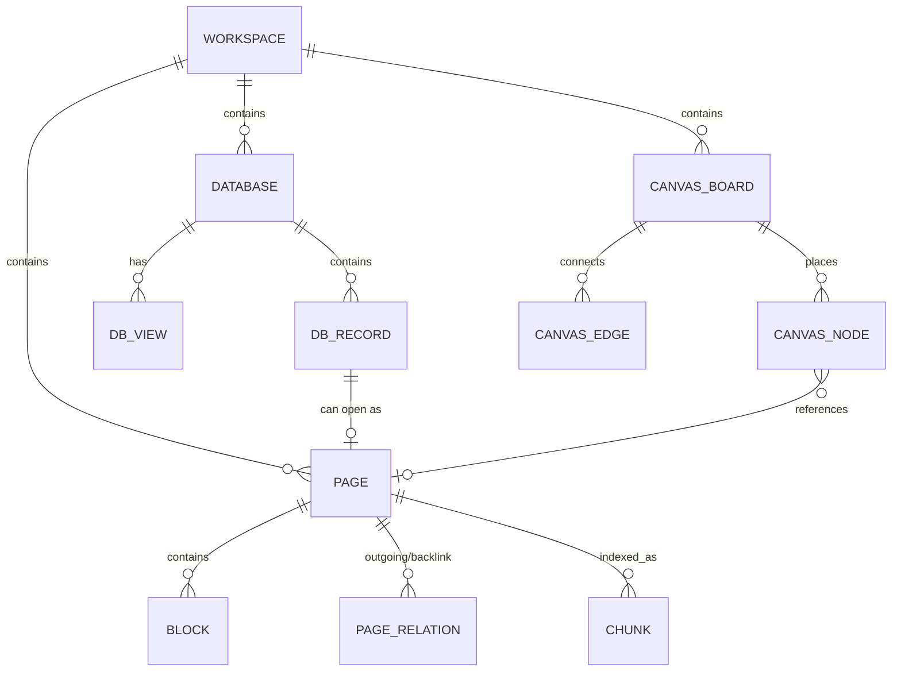

# Mindora Canonical Data Model

## 1. Entity Relationship Diagram



---

## 2. Core Entities

### A. Workspace
```typescript
interface Workspace {
  id: string;
  name: string;
  icon?: string;
  createdAt: number;
  updatedAt: number;
}
```

### B. Page (Document)
```typescript
interface Page {
  id: string;
  workspaceId: string;
  title: string;
  content: string; // Markdown canonical representation
  icon?: string;
  parentId?: string | null; // For nested document hierarchies
  tags: string[];
  isFavorite: boolean;
  createdAt: number;
  updatedAt: number;
}
```

### C. Database & Records
```typescript
type PropertyType = 'text' | 'number' | 'select' | 'multi-select' | 'date' | 'checkbox' | 'url' | 'relation';

interface DatabaseProperty {
  id: string;
  name: string;
  type: PropertyType;
  options?: string[]; // For select & multi-select
}

interface DatabaseRecord {
  id: string;
  databaseId: string;
  title: string;
  properties: Record<string, any>;
  pageId?: string; // Associated document for full-page notes
  createdAt: number;
  updatedAt: number;
}

interface Database {
  id: string;
  workspaceId: string;
  title: string;
  description?: string;
  properties: DatabaseProperty[];
  views: Array<{
    id: string;
    name: string;
    type: 'table' | 'board' | 'list' | 'gallery';
    groupByProperty?: string;
  }>;
  createdAt: number;
  updatedAt: number;
}
```

### D. Canvas & Visual Nodes
```typescript
interface CanvasNode {
  id: string;
  boardId: string;
  type: 'card' | 'sticky' | 'page-ref' | 'image';
  title?: string;
  content?: string;
  pageId?: string;
  x: number;
  y: number;
  width: number;
  height: number;
  color?: string;
}

interface CanvasEdge {
  id: string;
  boardId: string;
  fromNodeId: string;
  toNodeId: string;
  label?: string;
}
```

### E. AI Vector Chunks & Citations
```typescript
interface DocumentChunk {
  id: string;
  pageId: string;
  pageTitle: string;
  chunkIndex: number;
  text: string;
  embedding?: number[]; // Vector embedding
  headingContext?: string;
}
```

