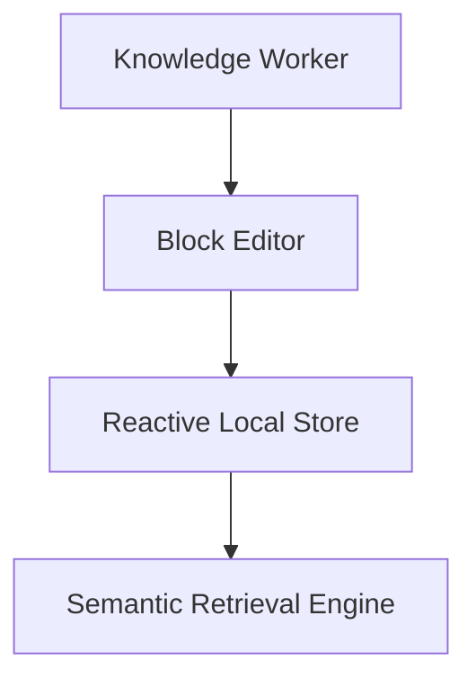
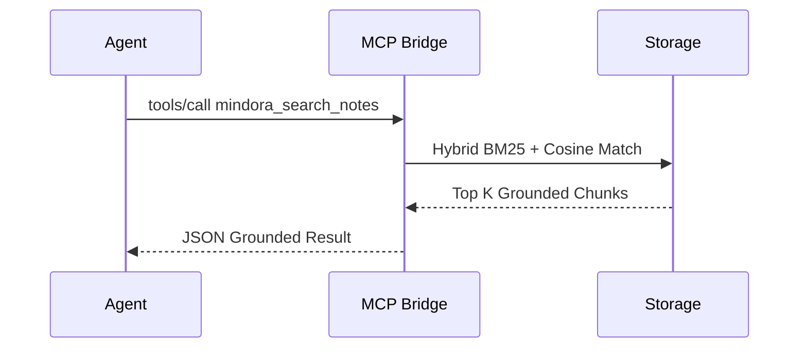

# Mindora Mermaid Diagram & Visual Architecture Guide

Mindora natively renders Mermaid diagrams both in markdown documents and inside the visual infinite canvas.

---

## 1. Supported Diagram Types

### Flowcharts (`flowchart TD` / `graph LR`)

### Sequence Diagrams (`sequenceDiagram`)

### Visual Whiteboard Canvas Integration
- Cards can be connected using directional bezier curve arrows.
- Anchor ports automatically calculate optimal curve tangents.
- Arrowhead markers maintain vector crispness across all zoom levels (40% to 200%).
